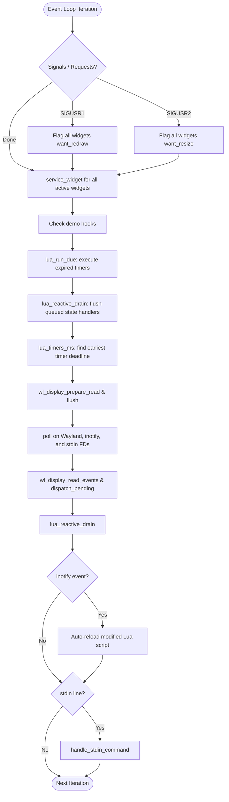
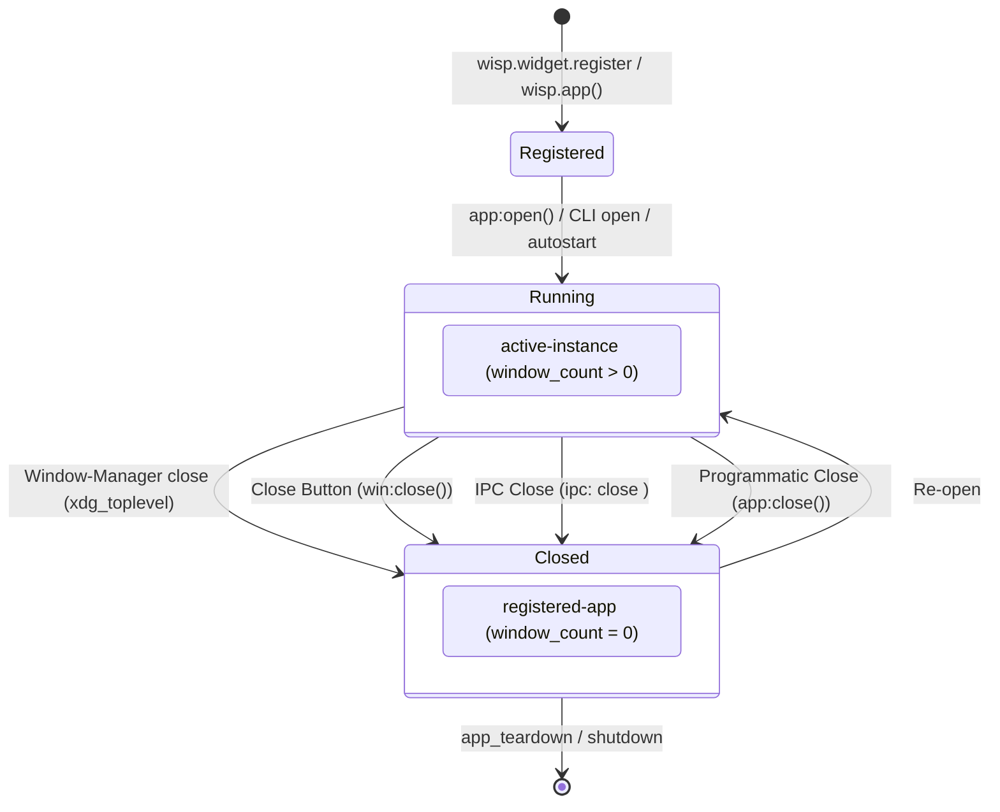

# Runtime Architecture

This document describes the internal runtime architecture, module division, event loop execution model, Wayland subsystem integration, rendering pipeline, and resource ownership rules of **WISP**.

Related documentation:
- [Lua Widget API](api.md)
- [Development Guide](development.md)

---

## Architectural Principles

1. **Zero-Polling Execution**: WISP never executes busy loops or permanent frame ticks. The entire process blocks inside `poll(2)` until an external event (Wayland protocol event, file modification, stdin command, or scheduled timer deadline) wakes it. Between scheduled deadlines, CPU utilization is strictly **0.00%**.
2. **Single Process, Multi-Widget**: A single native Linux process hosts up to `MAX_WIDGETS` (8) independent Wayland surfaces. This eliminates the duplicate overhead of running separate runtimes, D-Bus connections, and compositor protocol streams per widget.
3. **Strict C / Lua Separation**: The native C runtime retains complete ownership of system-level resources (Wayland protocol objects, shared-memory file descriptors, memory mappings, FreeType faces, and asset caches). Lua scripts run inside sandboxed coroutine threads with access only to safe, high-level primitives.
4. **Bounded Memory & Static Allocations**: Core tables (widgets, outputs, image caches, scaled buffers, glyph caches) use bounded static or direct-indexed arrays. Dynamic heap allocations are constrained and tracked.
5. **Fault Isolation**: Lua script execution errors or crashes in one widget do not terminate the process or affect neighboring widgets. Failing callbacks are disabled safely, and invalid hot-reloads automatically roll back to the last working version.

---

## High-Level System Architecture

```text
                  +---------------------------------------------+
                  |               WISP Process                 |
                  |                                             |
                  |   +-------------------------------------+   |
                  |   |            Widget Manager           |   |
                  |   |      (Registry, Lifecycles, IPC)    |   |
                  |   +------------------+------------------+   |
                  |                      |                      |
                  |   +------------------+------------------+   |
                  |   |        Lua Scripting Runtime        |   |
                  |   |    (Single VM, Sandboxed Threads)   |   |
                  |   |  [Widget 1 Env]  ... [Widget N Env] |   |
                  |   +------------------+------------------+   |
                  |                      |                      |
                  |   +------------------+------------------+   |
                  |   |        2D Rendering Engine          |   |
                  |   |  - Shapes (rect, rrect, circle)     |   |
                  |   |  - FreeType Glyph Cache (128 slots) |   |
                  |   |  - Image / SVG Cache & Bilinear     |   |
                  |   |  - Reusable SHM Pixels (memfd)      |   |
                  |   +------------------+------------------+   |
                  |                      |                      |
                  |   +------------------+------------------+   |
                  |   |           Wayland Backend           |   |
                  |   |  - wl_compositor & wl_surface       |   |
                  |   |  - zwlr_layer_shell_v1 (OVERLAY)    |   |
                  |   |  - wl_shm & wl_buffer               |   |
                  |   |  - Multi-output scale tracker       |   |
                  |   +------------------+------------------+   |
                  +----------------------|----------------------+
                                         | Wayland UNIX Socket
                                         v
                  +---------------------------------------------+
                  |               Wayland Compositor            |
                  |       (Sway / Hyprland / MangoWC / River)   |
                  +---------------------------------------------+
```

---

## Module Responsibilities

The codebase is organized into modular subsystems under `src/`:

| Module | Source Files | Responsibilities |
|---|---|---|
| **Core** | `src/core/main.c`<br>`src/core/widget.c`<br>`src/core/config.c`<br>`src/core/types.h` | Application entry point, CLI flag parsing, top-level event loop, widget table management, Lua configuration system (`wisp.lua`), signal handling. |
| **Wayland** | `src/wayland/wayland.c`<br>`src/wayland/wayland.h` | Wayland display connection, registry global discovery, surface creation, layer-shell surface lifecycle, output detection, and dynamic scale tracking. |
| **Render** | `src/render/buffer.c`<br>`src/render/shapes.c`<br>`src/render/text.c`<br>`src/render/image.c`<br>`src/render/clay_render.c` | Software 2D rasterization, clipping, dirty-region tracking, `memfd_create` shared-memory buffer allocation, FreeType font rasterization, PNG (stb_image) and SVG (NanoSVG) loading, Clay render command rasterizer. |
| **Scripting** | `src/scripting/scripting.c`<br>`src/scripting/scripting.h` | Embedded Lua 5.4 VM lifecycle, memory-accounting allocator, instruction-step hook budgets, widget environment sandboxing, Neovim-style hierarchical C-Lua API bindings (`wisp.ui.*`, `wisp.layout.*`, `wisp.widget.*`, `wisp.timer.*`, `wisp.system.*`, `wisp.style.*`), state-preserving hot reload. |
| **Layout** | `src/layout/layout.c`<br>`src/layout/layout.h`<br>`src/layout/clay_layout.c`<br>`src/layout/clay_layout.h` | Clay layout engine initialization, memory arena management, FreeType text measurement integration, recursive Lua table-to-Clay layout generation, anchor string parsing (`parse_anchor`) and linear stack calculation. |
| **Services** | `src/services/system.c`<br>`src/services/service.c`<br>`src/services/service.h`<br>`src/services/*.c` | Native Linux system metrics (`sys_get_battery`, `sys_get_cpu`, `sys_get_memory`, `sys_get_uptime`, `sys_get_loadavg`), monotonic clock timestamp provider (`now_us()`), filesystem path splitting (`get_dir_and_file`). Table-driven service registry: lazy init, deterministic reverse-order cleanup, snapshot publication with revision counters, mark/dispatch push pipeline. |
| **IPC** | `src/ipc/ipc.c`<br>`src/ipc/ipc.h`<br>`src/ipc/frame.c`<br>`src/ipc/frame.h` | Stdin line protocol (unchanged) plus a framed JSON command protocol over the daemon socket (`gen` nonce, closed verb table, 64 KiB cap, dual-stack line protocol for legacy clients). |

---

## Unified Service Registry, Snapshots and Push Pipeline

`src/services/service.c` provides a table-driven registry for the eight native services
(process, fs, audio, qr, notify, screen, clipboard, keyboard). It replaces the previously
eager, triplicated init/shutdown call lists (startup, cleanup, selftest) with a single
lifecycle per service:

- **Registration** — a static `struct service_def` per service (name, init, shutdown,
  optional dispatch flush hook).
- **Lazy initialization** — `service_request(id)` starts a service on first request and is
  idempotent. `ACTIVE` services return immediately; `FAILED` services stay `FAILED`;
  unrequested services consume nothing (notably: no `inotify_fd`, no PulseAudio mainloop,
  no sd-bus connection when the config never touches audio/fs/notify).
  Lua-visible laziness is via a C-closure guard in `src/scripting/scripting.c`: upvalue 1 =
  service id, upvalue 2 = the real `lua_CFunction`, upvalue 3 = service name. If init
  fails the guard raises `wisp: <name> service unavailable` instead of calling into
  half-initialized state.
- **Failure unwinding** — fallible inits (audio PA objects, fs inotify, notify sd-bus,
  screen pipe) release partial resources and call `service_mark_failed()`; nothing
  half-initialized survives.
- **Cleanup** — `service_registry_shutdown()` shuts down `ACTIVE` services in reverse
  registration order. All shutdowns are idempotent, so double-shutdown is safe.
- **Snapshot publication** — `service_snapshot_publish(id, hash)` hashes the meaningful
  payload (FNV-1a) and publishes only when the hash differs from the last one. The first
  publication is revision 1; identical snapshots bump nothing and produce no notification.
  Consumers detect missed updates by comparing the monotonically increasing `revision`
  field attached to every pushed payload.
- **Push pipeline** — services never call Lua from inside push callbacks: they call
  `service_snapshot_publish()` (hash compare) and `service_notify_mark()`; the main loop
  calls `service_dispatch_pending()` right after the service ticks, which runs each
  service's flush hook (audio sends the subscription payload with the current revision).
  `wisp.audio.subscribe_change` callbacks therefore run in the main loop, not inside
  PulseAudio or sd-bus callbacks.

Snapshot ownership is explicit: services own their snapshot state in static storage,
`service_snapshot_publish` stores only the hash/revision in the registry, and there is no
dynamic snapshot allocation.

### Reactive State Dispatch

Reactive state (`wisp.state`, `wisp.computed`, `wisp.effect`) never runs Lua handlers inline.
The dispatch path:

- **Writes bump versions, not handlers** — `set`/`update`/table-field writes enqueue the
  state's subscribed handlers via `wisp._enqueue(fn, state)`. State tables carry a per-state
  `_ver` counter (and `_old`); equal writes do not bump it. Table-field writes compare
  before bumping. Enqueue is also the redraw latch, not the handler runner.
- **Fixed, bounded C queue** — entries (`{fn_ref, state_ref, old_ref, gen}` + `lua_topointer` identity
  keys) live in a static `disp_queue[256]`; dedup is an identity compare, no Lua API round
  trips on the scan, no allocation per write. `old_ref` stores the value the state held at the
  first write of the batch, so a coalesced notification reports `(new, old-at-batch-start)`.
  Overflow drops notifications and reports once per drain.
- **Flush at defined points only** — the main loop calls `lua_reactive_drain()` right after
  both `service_dispatch_pending()` call sites (post-tick and post-poll). Drain never runs
  inside a writer; nested writes during dispatch land in the next round.
- **Bounded rounds** — a drain runs at most 8 rounds. Leftover entries (e.g. unbounded
  recursive self-writes) are released and reported as dropped, so a recursive handler can
  never spin the event loop.
- **Instruction budget per handler** — every dispatched handler runs with the
  `lua_tick_hook` armed and `lua_ticks = lua_ticks_total`; an infinite-loop handler trips
  `luaL_error`, the drain reports it and continues with the remaining entries.
- **Version-gated computed/effect** — `wisp.computed`/`wisp.effect` snapshot dep `_ver` at
  (re)compute time and return early when unchanged; two dep writes in one flush recompute
  once. Nested dep writes during a compute are absorbed by a pre-compute snapshot.
- **Generation invalidation (stale discard)** — a successful staged widget reload
  (`lua_widget_reload_from_source`) bumps the global `wisp_lua_gen` and purges the queue and
  the timer table: pre-reload handlers (registry refs into the replaced environment) are
  released unrun, and pre-reload timers are discarded unfired. Failed reloads never bump the
  generation, so rolling back to the previous version preserves pending work.
- **API compatibility** — state tables keep `_val/_subs/_apps`; get/set/update/subscribe,
  callable states, table-field writes, `wisp.state.computed` and `wisp.state.batch` behave as
  before. `wisp._flush()` is exposed for tests and deterministic drain points.

### IPC Frame Protocol

`src/ipc/frame.c/.h` adds a 4-byte big-endian length-prefixed JSON frame protocol on the
daemon socket, mirroring the Mantle framing pattern (sized to Wisp's actual message sizes —
not Mantle's 16 MiB cap):

- **Limit**: `IPC_MAX_FRAME = 65536` bytes. Commands are a few KiB at most.
- **Frames**: request `{"gen":N,"verb":"open","args":["a","b"]}`; response
  `{"gen":N,"ok":true,"text":"..."}`. `gen` is an opaque client nonce echoed verbatim so
  callers can correlate responses; the daemon does not interpret it.
- **Closed verb table** (`ipc_verb_valid`): `open close toggle reload list apps status
  load unload stop kill`. Anything else is rejected with an error frame before execution.
- **State machine**: the daemon holds at most `IPC_MAX_CLIENTS` (4) one-shot connections.
  Reads accumulate sniff → header → payload (or legacy line) and writes drain through the
  poll loop (`ipc_server_poll` fills fixed `pfds` slots; `ipc_server_handle_poll` services
  them). No blocking reads, no unbounded buffers, and a full response is always flushed
  before the daemon exits (`while (running || ipc_has_pending_writes())`).
- **Invalid-frame rejection**: prefix claiming more than `IPC_MAX_FRAME`, malformed JSON,
  unknown keys, wrong types, or unknown verbs are rejected with an error frame; truncated
  frames are dropped. Oversized payloads are never allocated.
- **Migration (dual-stack)**: the server sniffs the first bytes — `00 00` + length ≤ cap
  means framed; anything else is treated as the legacy line protocol and receives the
  legacy raw-text response. Existing line-protocol clients (hand-written `printf 'status\n'
  | socat - UNIX-CONNECT:...`) keep working unchanged. New CLI always frames; a legacy
  daemon answers a framed request with nothing, so a new CLI against a pre-frame daemon
  fails after a 2 s read timeout with a clear message — clients and daemon should be
  upgraded together. The CLI's unknown-verb fallback (`wisp calendar` ≡ `wisp open calendar`)
  is unchanged.
- Output text is identical on both protocols (both paths execute through the shared
  `ipc_execute_command`, captured via `open_memstream`).

## Event Loop Execution Model

WISP's event loop is implemented in `src/core/main.c` around `poll(2)`.



### File Descriptors Polled
1. **Wayland Display FD** (`wl_display_get_fd`): Listens for incoming protocol events from the compositor (configure, buffer release, output scale change, surface enter/leave).
2. **Inotify FD** (`inotify_fd`): Monitors parent directories of active Lua widget scripts for writes, creates, and atomic renames.
3. **Standard Input FD** (FD 0): Reads line-oriented text commands from the terminal or piped scripts. When EOF is encountered, this FD is disabled from polling.

### Dynamic Timeout Computation
The poll timeout argument is calculated on every iteration:
```c
int timeout = lua_timers_ms(now_us());
```
- If one or more widgets have active Lua timers, `timeout` is the number of milliseconds remaining until the earliest timer expires (clamped to 0 if already due).
- If no widgets have active timers (or all widgets are hidden/native), `timeout` evaluates to `-1`, instructing the Linux kernel to sleep indefinitely until an external I/O event arrives.
- A pending config reload (see *Config Watcher* below) additionally clamps `timeout` to the remaining debounce interval so the reload fires even with no timers or I/O pending. When no reload is pending, the timeout is untouched and the idle loop remains zero-CPU.

---

## Wayland Subsystem Integration

WISP communicates with Wayland compositors using `libwayland-client` and the unstable layer-shell protocol `zwlr_layer_shell_v1` (version 1 to 4).

### Global Binding
During initialization, WISP binds the following globals:
- `wl_compositor` (version 1–6): Creates native surfaces (`wl_surface`) and input regions.
- `wl_shm` (version 1): Shared-memory allocator. Verifies `WL_SHM_FORMAT_ARGB8888` availability.
- `zwlr_layer_shell_v1` (version 1–4): Assigns surfaces to the desktop overlay layer.
- `wl_output` (version 1–2): Tracks active monitor geometry, physical dimensions, and integer scale factors across up to 8 outputs.

### Surface Configuration & Input Routing
Each widget creates a dedicated `wl_surface` and layer surface configured with:
- **Layer**: `ZWLR_LAYER_SHELL_V1_LAYER_OVERLAY` (always floats above standard application windows).
- **Keyboard Interactivity**: `ZWLR_LAYER_SURFACE_V1_KEYBOARD_INTERACTIVITY_NONE` (widgets never steal keyboard focus).
- **Input Region**: An empty region (`0x0x0x0`) is applied to every surface via `wl_surface_set_input_region()`. Mouse clicks pass directly through to desktop windows below.

---

## 2D Software Rendering Pipeline

Rendering is entirely software-driven with direct ARGB8888 pixel manipulation, avoiding GPU contexts, Mesa overhead, or heavy rendering libraries.

### Pixel Format & Memory Management
- **Pixel Format**: 32-bit premultiplied ARGB (`0xAARRGGBB`), native byte order on little-endian Linux.
- **Backing Memory**: Each widget allocates a single anonymous memory file descriptor via `memfd_create("wisp", 0)` and maps it using `mmap(..., MAP_SHARED)`. A single `wl_buffer` wraps this shared memory via `wl_shm_pool_create_buffer()`.
- **Double-Buffering & Buffer States**:
  To prevent tearing and race conditions without allocating duplicate buffers, widgets follow a tri-state lifecycle:
  - `BUF_AVAILABLE`: Buffer is ready for writing.
  - `BUF_ATTACHED`: Buffer has been committed to Wayland compositor and is awaiting display.
  - `BUF_BUSY`: Redraw requested while compositor still holds the buffer. Redraw is deferred until the compositor emits `wl_buffer.release`.

### Render & Damage Steps
1. **Clear / Background Fill**: The surface memory is filled with the widget's background color (`fill_rect`).
2. **Callback Execution**: Lua's `on_draw()` callback or native drawing routines execute drawing operations (`text`, `rect`, `rrect`, `circle`, `line`, `image`).
3. **Dirty-Region Bounding**: Every drawing primitive updates the widget's `struct rect dmg` accumulator bounding box.
4. **Duplicate Frame Suppression**: Before committing, `frame_same()` compares the new damage box, fill color, and active scaled image pointer against the previous frame. If nothing changed, the commit is skipped.
5. **Commit**: `wl_surface_attach()`, `wl_surface_damage()`, and `wl_surface_commit()` submit the updated pixels to the compositor.

---

## Resource Ownership & Lifecycle

| Resource | Allocator / Owner | Cleanup Location |
|---|---|---|
| `wl_display`, `wl_registry`, globals | Main process startup (`main.c`) | `cleanup` label in `main.c` |
| `wl_surface`, `zwlr_layer_surface_v1` | `widget_add` in `src/core/widget.c` | `widget_teardown` |
| Shared-memory buffer (`memfd`, `mmap`) | `alloc_buffer` in `src/render/buffer.c` | `munmap` and `wl_buffer_destroy` in `widget_teardown` |
| Master Lua VM (`lua_State *Lm`) | `lua_vm_init` in `src/scripting/scripting.c` | `shutdown_lua` |
| Widget Lua Thread & Registry Refs | `lua_widget_from_source` | `lua_widget_free` |
| FreeType Face & 128-slot Glyph Cache | `init_text` in `src/render/text.c` | `shutdown_text` |
| Master Image (`struct image`) | `image_get` in `src/render/image.c` | `shutdown_images` / `image_release` |
| Scaled Bilinear Pixels (`struct img_scaled`) | `scaled_get` in `src/render/image.c` | `scaled_release` / LRU eviction |
| Inotify Watches (`watch_wd`) | `lua_widget_load` in `src/scripting/scripting.c` | `inotify_rm_watch` when reference drops to 0 |

---

## Wisp 2.0 Dual Rendering Pipeline & Declarative UI Engine

Wisp 2.0 enforces a strict architectural separation between immediate vector drawing and declarative component rendering:

### 1. Immediate Graphics Pipeline (`wisp.draw`)
When `wisp.draw()` is defined:
- **Bypasses Clay completely**: Layout calculation overhead is completely avoided.
- **Direct Hardware Acceleration**: Primitive drawing calls (`wisp.graphics.*`) stream directly into NanoVG/EGL vertex buffers or the native software rasterizer.
- **Configurable Frame Scheduling**: When `wisp.opt.fps` is set and `wisp.update(dt)` is defined, frame updates run at fixed delta-time intervals using monotonic clock timestamps; otherwise the application remains completely idle and only draws on invalidation.

### 2. Declarative UI Pipeline (`wisp.render`)
When `wisp.render()` is defined:
- **Concise Table Syntax**: Returns an ergonomic tree of Lua tables (`wisp.ui.col`, `wisp.ui.row`, `wisp.ui.card`, `wisp.ui.button`, etc.).
- **Clay Layout Compilation**: The table hierarchy is compiled directly into Clay layout nodes (`clay_build_from_lua`) with zero extraneous abstraction layers.
- **Selective Dirty-State Invalidation**: Declarative applications do not redraw continuously at 60 FPS. Redraws are only scheduled when reactive state changes (`wisp.state`) or Wayland interaction events (click, hover, scroll, keypress) occur.
- **Mutual Exclusivity**: Immediate drawing and declarative rendering operate on dedicated code paths per window, preventing accidental dual-pipeline execution.

---

## Application Lifecycle & Teardown Architecture

Wisp distinguishes between static widget surfaces (`layer_shell`) and full-fledged desktop applications (`wisp.app`, `xdg_shell`).



### Automatic Final-Window Teardown
When the final window belonging to a running application closes through any path:
1. **Window-Manager Close**: Compositor sends `xdg_toplevel.close`, invoking `widget_teardown` which triggers `app_remove_window`.
2. **Close Button**: `win:close()` in Lua calls `wisp.widget.destroy(id)`.
3. **IPC Close**: IPC command `close <name>` locates the running app and calls `app_close(name)`.
4. **Programmatic Close**: Lua script invokes `app:close()`.

When `app->window_count == 0`:
- **State Transition**: `app->state` transitions from `APP_STATE_RUNNING` to `APP_STATE_CLOSED`.
- **IPC & CLI Registry Status**: Listed as `registered-app` rather than `active-instance`.
- **System Services Cleanup**: All active asynchronous subscriptions, streaming child processes, inotify watches, audio streams, and clipboard monitors belonging to the application's slot are terminated.
- **Lua Environment Cleanup**: Invokes `wisp._app_cleanup(name)` to clear all reactive state subscriptions (`state._subs = {}`), releases active app context, and unreferences Lua callback registry slots (`lua_init_ref`, `lua_close_ref`, `lua_build_ref`, `lua_env_ref`).
- **Resource Reclaim**: Zero memory leakage or file descriptor retention across repeated open/close lifecycles.

---

## Config Watcher (Dedup + Debounce)

The config file's parent directory is watched via inotify (`IN_CLOSE_WRITE | IN_MOVED_TO | IN_CREATE | IN_DELETE | IN_MOVED_FROM`), matching the Mantle watcher pattern:

1. **Content dedup**: every relevant event hashes the config file contents (FNV-1a, `config_file_hash()`); byte-identical saves (editors that rewrite the same content, `touch`, some sync tools) never trigger a reload. The hash of the last *applied* config is recorded in `config_init()`/`config_reload()`.
2. **Debounce**: non-identical events push into a burst (`config_burst_push()`). The reload fires after 200 ms of quiet (`CONFIG_QUIET_US`), but never later than 2 s after the burst's first event (`CONFIG_MAX_US`). The poll-loop timeout is clamped to the remaining debounce so the reload cannot be starved by idle.
3. **Delete / rename-away**: emits one warning and keeps the last working configuration; no reload is queued.
4. **IN_Q_OVERFLOW**: the event queue overflow is recovered by re-hashing the config directly (`config_note_overflow()`); a reload is queued only if the content actually differs from the applied hash.

The burst logic is pure and unit-tested (`config_burst_push/due/due_in_us`).

## Daemon Restart Brake

`spawn_daemon()`-started daemons that exit abnormally are re-executed through a Mantle `generation.rs`-style brake:

- At most **3 restarts per 60 s window**; exceeding the limit applies a **30 s cooldown** once, then the daemon stays dead (no infinite restart loop).
- Restart state (`restarts,window_start,cooled`) crosses `exec(2)` via the `WISP_RESTART_STATE` environment variable.
- If the compositor/session is gone (`wl_display_connect` failure, registry/roundtrip failure, missing globals, `POLLERR/HUP` on the display fd, wayland read/dispatch failure, `wl_display_dispatch_pending` failure) no restart is attempted at all.
- Counters reset after a stable window, so normal long-running operation never accumulates.

## Configuration Validation Mode (`wisp --check`)

`wisp --check` validates the real Lua configuration (default path or `-c <file>`) through the production loader (`lua_config_execute()`) and the existing staging mechanism, with no surfaces, services, or widget runtime:

- Side-effecting bindings (`process.spawn/exec`, `fs.write/mkdir/remove`, `notify.send`, `screen.capture`, `clipboard.set/clear`, `audio.set_volume/set_muted`) are replaced by deterministic stand-ins via `lua_check_mode_stubs()`; read-only services stay real.
- Dependency validation is escalated from warning to error, and every widget script path is checked for readability.
- Exit code 0 on success, 1 on failure; the live config state and the daemon are left untouched.

## Hot-Reload & Rollback Engine

When a monitored Lua script file is modified on disk:
1. An inotify event (`IN_CLOSE_WRITE`, `IN_MOVED_TO`, or `IN_CREATE`) triggers `lua_widget_reload()`.
2. A temporary sandboxed Lua coroutine thread is created on the master VM.
3. The existing `state` table is cloned into the new environment so widget state is preserved across reloads.
4. The new script is parsed and executed under instruction budgets.
5. **If compilation or execution succeeds**: The old thread and its registry references are released, the new thread is adopted, and an `on_event("reloaded")` event is fired.
6. **If compilation fails (syntax error, runtime error, OOM)**: The new thread is discarded, the error is logged to `stderr`, and the existing widget continues executing uninterrupted using its previous version.


## Wayland integration (summary)

- Uses `libwayland-client` with `zwlr_layer_shell_v1` (layer widgets/overlays) and `xdg_shell` for app windows. Requires a compositor that supports the needed protocols (Sway, Hyprland, MangoWC, River, Labwc, Wayfire commonly work; GNOME Mutter does not support `zwlr_layer_shell_v1`; KDE behavior varies).
- Layer surfaces use overlay layer by default patterns; input regions are configured so non-interactive areas can be click-through where intended. Keyboard interactivity is opt-in per widget/app behavior.
- Buffers use shared memory (`wl_shm`, ARGB8888). Rendering is software rasterization with damage tracking and deferred redraws while buffers are in use. HiDPI uses integer buffer scales; fractional scaling behavior depends on compositor.
- Screen capture uses `zwlr_screencopy_v1` when available (wlroots-based compositors typically). Portals-based capture paths are not used by this native path.
- Pointer/keyboard support depends on compositor/protocol availability; some interactive features are experimental. See `docs/SKILL.md` for authoring guidance and current API behavior.

## Known limitations (high level)

- No X11 support; Wayland-only. GNOME (Mutter) lacks required layer-shell support.
- Lua `os.execute`/`io.popen` are sandboxed out in the Lua runtime.
- Single-threaded event loop: long synchronous Lua work can block until it yields/finishes under budgets.
- Fixed capacity limits (widgets/outputs/images/scaled caches/glyph slots) as defined in code; exceeding limits fails cleanly.
- Image support is effectively PNG/SVG via vendored decoders in practice (see implementation); other formats are not guaranteed.
- Declarative UI has sizing/layout edge cases in some advanced scenarios; verify critical layouts. Interactive input coverage depends on compositor support.
- Native-only builds (`-Dlua=false`) do not run Lua configs/apps; use appropriate build mode.

For up-to-date behavior, verify against the source tree and `--selftest`.
