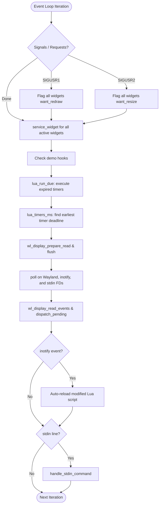

# Runtime Architecture

This document describes the internal runtime architecture, module division, event loop execution model, Wayland subsystem integration, rendering pipeline, and resource ownership rules of **WISP**.

Related documentation:
- [Lua Widget API](api.md)
- [Wayland Integration](wayland.md)
- [Performance & Benchmarks](performance.md)
- [Development Guide](development.md)

---

## Architectural Principles

1. **Zero-Polling Execution**: WISP never executes busy loops or permanent frame ticks. The entire process blocks inside `poll(2)` until an external event (Wayland protocol event, file modification, stdin command, or scheduled timer deadline) wakes it. Between scheduled deadlines, CPU utilization is strictly **0.00%**.
2. **Single Process, Multi-Widget**: A single native Linux process hosts up to `MAX_WIDGETS` (8) independent Wayland surfaces. This eliminates the duplicate overhead of running separate runtimes, D-Bus connections, and compositor protocol streams per widget.
3. **Strict C / Lua Separation**: The native C runtime retains complete ownership of system-level resources (Wayland protocol objects, shared-memory file descriptors, memory mappings, FreeType faces, and asset caches). Lua scripts run inside sandboxed coroutine threads with access only to safe, high-level primitives.
4. **Bounded Memory & Static Allocations**: Core tables (widgets, outputs, image caches, scaled buffers, glyph caches) use bounded static or direct-indexed arrays. Dynamic heap allocations are constrained and tracked.
5. **Fault Isolation**: Lua script execution errors or crashes in one widget do not terminate the process or affect neighboring widgets. Failing callbacks are disabled safely, and invalid hot-reloads automatically roll back to the last working version.

---

## High-Level System Architecture

```text
                  +---------------------------------------------+
                  |               WISP Process                 |
                  |                                             |
                  |   +-------------------------------------+   |
                  |   |            Widget Manager           |   |
                  |   |      (Registry, Lifecycles, IPC)    |   |
                  |   +------------------+------------------+   |
                  |                      |                      |
                  |   +------------------+------------------+   |
                  |   |        Lua Scripting Runtime        |   |
                  |   |    (Single VM, Sandboxed Threads)   |   |
                  |   |  [Widget 1 Env]  ... [Widget N Env] |   |
                  |   +------------------+------------------+   |
                  |                      |                      |
                  |   +------------------+------------------+   |
                  |   |        2D Rendering Engine          |   |
                  |   |  - Shapes (rect, rrect, circle)     |   |
                  |   |  - FreeType Glyph Cache (128 slots) |   |
                  |   |  - Image / SVG Cache & Bilinear     |   |
                  |   |  - Reusable SHM Pixels (memfd)      |   |
                  |   +------------------+------------------+   |
                  |                      |                      |
                  |   +------------------+------------------+   |
                  |   |           Wayland Backend           |   |
                  |   |  - wl_compositor & wl_surface       |   |
                  |   |  - zwlr_layer_shell_v1 (OVERLAY)    |   |
                  |   |  - wl_shm & wl_buffer               |   |
                  |   |  - Multi-output scale tracker       |   |
                  |   +------------------+------------------+   |
                  +----------------------|----------------------+
                                         | Wayland UNIX Socket
                                         v
                  +---------------------------------------------+
                  |               Wayland Compositor            |
                  |       (Sway / Hyprland / MangoWC / River)   |
                  +---------------------------------------------+
```

---

## Module Responsibilities

The codebase is organized into modular subsystems under `src/`:

| Module | Source Files | Responsibilities |
|---|---|---|
| **Core** | `src/core/main.c`<br>`src/core/widget.c`<br>`src/core/config.c`<br>`src/core/types.h` | Application entry point, CLI flag parsing, top-level event loop, widget table management, Lua configuration system (`wisp.lua`), signal handling. |
| **Wayland** | `src/wayland/wayland.c`<br>`src/wayland/wayland.h` | Wayland display connection, registry global discovery, surface creation, layer-shell surface lifecycle, output detection, and dynamic scale tracking. |
| **Render** | `src/render/buffer.c`<br>`src/render/shapes.c`<br>`src/render/text.c`<br>`src/render/image.c`<br>`src/render/clay_render.c` | Software 2D rasterization, clipping, dirty-region tracking, `memfd_create` shared-memory buffer allocation, FreeType font rasterization, PNG (stb_image) and SVG (NanoSVG) loading, Clay render command rasterizer. |
| **Scripting** | `src/scripting/scripting.c`<br>`src/scripting/scripting.h` | Embedded Lua 5.4 VM lifecycle, memory-accounting allocator, instruction-step hook budgets, widget environment sandboxing, Neovim-style hierarchical C-Lua API bindings (`wisp.ui.*`, `wisp.layout.*`, `wisp.widget.*`, `wisp.timer.*`, `wisp.system.*`, `wisp.style.*`), state-preserving hot reload. |
| **Layout** | `src/layout/layout.c`<br>`src/layout/layout.h`<br>`src/layout/clay_layout.c`<br>`src/layout/clay_layout.h` | Clay layout engine initialization, memory arena management, FreeType text measurement integration, recursive Lua table-to-Clay layout generation, anchor string parsing (`parse_anchor`) and linear stack calculation. |
| **Services** | `src/services/system.c`<br>`src/services/system.h` | Native Linux system metrics (`sys_get_battery`, `sys_get_cpu`, `sys_get_memory`, `sys_get_uptime`, `sys_get_loadavg`), monotonic clock timestamp provider (`now_us()`), filesystem path splitting (`get_dir_and_file`). |
| **IPC** | `src/ipc/ipc.c`<br>`src/ipc/ipc.h` | Standard input (stdin) command parser (`list`, `status`, `load`, `unload`, `reload`) and stdout status formatting. |

---

## Event Loop Execution Model

WISP's event loop is implemented in `src/core/main.c` around `poll(2)`.



### File Descriptors Polled
1. **Wayland Display FD** (`wl_display_get_fd`): Listens for incoming protocol events from the compositor (configure, buffer release, output scale change, surface enter/leave).
2. **Inotify FD** (`inotify_fd`): Monitors parent directories of active Lua widget scripts for writes, creates, and atomic renames.
3. **Standard Input FD** (FD 0): Reads line-oriented text commands from the terminal or piped scripts. When EOF is encountered, this FD is disabled from polling.

### Dynamic Timeout Computation
The poll timeout argument is calculated on every iteration:
```c
int timeout = lua_timers_ms(now_us());
```
- If one or more widgets have active Lua timers, `timeout` is the number of milliseconds remaining until the earliest timer expires (clamped to 0 if already due).
- If no widgets have active timers (or all widgets are hidden/native), `timeout` evaluates to `-1`, instructing the Linux kernel to sleep indefinitely until an external I/O event arrives.

---

## Wayland Subsystem Integration

WISP communicates with Wayland compositors using `libwayland-client` and the unstable layer-shell protocol `zwlr_layer_shell_v1` (version 1 to 4).

### Global Binding
During initialization, WISP binds the following globals:
- `wl_compositor` (version 1–6): Creates native surfaces (`wl_surface`) and input regions.
- `wl_shm` (version 1): Shared-memory allocator. Verifies `WL_SHM_FORMAT_ARGB8888` availability.
- `zwlr_layer_shell_v1` (version 1–4): Assigns surfaces to the desktop overlay layer.
- `wl_output` (version 1–2): Tracks active monitor geometry, physical dimensions, and integer scale factors across up to 8 outputs.

### Surface Configuration & Input Routing
Each widget creates a dedicated `wl_surface` and layer surface configured with:
- **Layer**: `ZWLR_LAYER_SHELL_V1_LAYER_OVERLAY` (always floats above standard application windows).
- **Keyboard Interactivity**: `ZWLR_LAYER_SURFACE_V1_KEYBOARD_INTERACTIVITY_NONE` (widgets never steal keyboard focus).
- **Input Region**: An empty region (`0x0x0x0`) is applied to every surface via `wl_surface_set_input_region()`. Mouse clicks pass directly through to desktop windows below.

---

## 2D Software Rendering Pipeline

Rendering is entirely software-driven with direct ARGB8888 pixel manipulation, avoiding GPU contexts, Mesa overhead, or heavy rendering libraries.

### Pixel Format & Memory Management
- **Pixel Format**: 32-bit premultiplied ARGB (`0xAARRGGBB`), native byte order on little-endian Linux.
- **Backing Memory**: Each widget allocates a single anonymous memory file descriptor via `memfd_create("wisp", 0)` and maps it using `mmap(..., MAP_SHARED)`. A single `wl_buffer` wraps this shared memory via `wl_shm_pool_create_buffer()`.
- **Double-Buffering & Buffer States**:
  To prevent tearing and race conditions without allocating duplicate buffers, widgets follow a tri-state lifecycle:
  - `BUF_AVAILABLE`: Buffer is ready for writing.
  - `BUF_ATTACHED`: Buffer has been committed to Wayland compositor and is awaiting display.
  - `BUF_BUSY`: Redraw requested while compositor still holds the buffer. Redraw is deferred until the compositor emits `wl_buffer.release`.

### Render & Damage Steps
1. **Clear / Background Fill**: The surface memory is filled with the widget's background color (`fill_rect`).
2. **Callback Execution**: Lua's `on_draw()` callback or native drawing routines execute drawing operations (`text`, `rect`, `rrect`, `circle`, `line`, `image`).
3. **Dirty-Region Bounding**: Every drawing primitive updates the widget's `struct rect dmg` accumulator bounding box.
4. **Duplicate Frame Suppression**: Before committing, `frame_same()` compares the new damage box, fill color, and active scaled image pointer against the previous frame. If nothing changed, the commit is skipped.
5. **Commit**: `wl_surface_attach()`, `wl_surface_damage()`, and `wl_surface_commit()` submit the updated pixels to the compositor.

---

## Resource Ownership & Lifecycle

| Resource | Allocator / Owner | Cleanup Location |
|---|---|---|
| `wl_display`, `wl_registry`, globals | Main process startup (`main.c`) | `cleanup` label in `main.c` |
| `wl_surface`, `zwlr_layer_surface_v1` | `widget_add` in `src/core/widget.c` | `widget_teardown` |
| Shared-memory buffer (`memfd`, `mmap`) | `alloc_buffer` in `src/render/buffer.c` | `munmap` and `wl_buffer_destroy` in `widget_teardown` |
| Master Lua VM (`lua_State *Lm`) | `lua_vm_init` in `src/scripting/scripting.c` | `shutdown_lua` |
| Widget Lua Thread & Registry Refs | `lua_widget_from_source` | `lua_widget_free` |
| FreeType Face & 128-slot Glyph Cache | `init_text` in `src/render/text.c` | `shutdown_text` |
| Master Image (`struct image`) | `image_get` in `src/render/image.c` | `shutdown_images` / `image_release` |
| Scaled Bilinear Pixels (`struct img_scaled`) | `scaled_get` in `src/render/image.c` | `scaled_release` / LRU eviction |
| Inotify Watches (`watch_wd`) | `lua_widget_load` in `src/scripting/scripting.c` | `inotify_rm_watch` when reference drops to 0 |

---

## Hot-Reload & Rollback Engine

When a monitored Lua script file is modified on disk:
1. An inotify event (`IN_CLOSE_WRITE`, `IN_MOVED_TO`, or `IN_CREATE`) triggers `lua_widget_reload()`.
2. A temporary sandboxed Lua coroutine thread is created on the master VM.
3. The existing `state` table is cloned into the new environment so widget state is preserved across reloads.
4. The new script is parsed and executed under instruction budgets.
5. **If compilation or execution succeeds**: The old thread and its registry references are released, the new thread is adopted, and an `on_event("reloaded")` event is fired.
6. **If compilation fails (syntax error, runtime error, OOM)**: The new thread is discarded, the error is logged to `stderr`, and the existing widget continues executing uninterrupted using its previous version.
