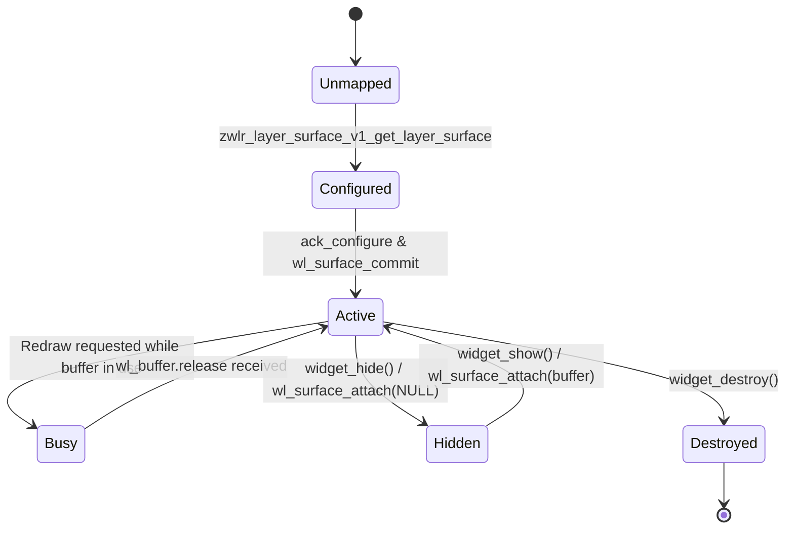
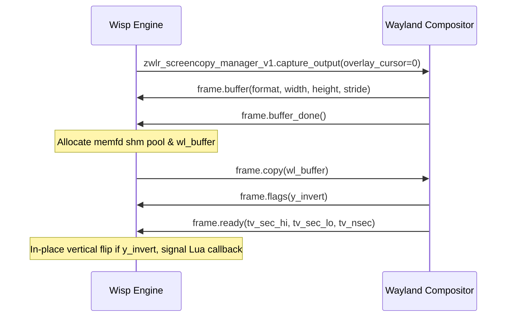

# Wayland Integration & Compositor Guide

This document describes WISP's Wayland client implementation, layer-shell surface lifecycle, buffer management, output scaling, compositor compatibility, and troubleshooting steps.

Related documentation:
- [Architecture](architecture.md)
- [Configuration Guide](configuration.md)
- [Performance & Benchmarks](performance.md)

---

## Wayland Architecture & Protocols

WISP interfaces directly with Wayland compositors via `libwayland-client` without intermediary toolkits (GTK, Qt) or X11 compatibility layers.

### Required Protocols

| Protocol | Version | Interface | Purpose |
|---|---|---|---|
| Wayland Core | >= 1 | `wl_compositor` | Creates native surfaces (`wl_surface`) and input regions. |
| Wayland Core | >= 1 | `wl_shm` | Shared-memory buffer allocator (`WL_SHM_FORMAT_ARGB8888`). |
| Wayland Core | >= 2 | `wl_output` | Multi-monitor output geometry and scaling detection. |
| WLR Layer Shell | 1–4 | `zwlr_layer_surface_v1` | Anchors surfaces to desktop layers (overlay). |
| WLR Screencopy | 1–3 | `zwlr_screencopy_manager_v1` | High-performance asynchronous desktop screen capture. |
| WLR Data Control | 1–2 | `zwlr_data_control_manager_v1` | Background clipboard management and change monitoring. |

> [!IMPORTANT]
> A desktop Wayland compositor supporting `zwlr_layer_shell_v1` is required. Standard Weston or pure GNOME Mutter sessions that lack the WLR layer-shell protocol cannot run WISP directly.

---

## Layer Shell Behavior

Each widget corresponds to an independent `zwlr_layer_surface_v1` surface.

### Layer Assignment
Widgets are assigned to `ZWLR_LAYER_SHELL_V1_LAYER_OVERLAY`. This places widgets above regular tiled or floating application windows, ensuring consistent desktop visibility.

### Keyboard & Pointer Interactivity
- **Keyboard**: Explicitly disabled (`ZWLR_LAYER_SURFACE_V1_KEYBOARD_INTERACTIVITY_NONE`). Widgets never take keyboard focus or intercept global hotkeys.
- **Pointer & Touch**: An empty input region (`0x0x0x0`) is committed to the surface via `wl_surface_set_input_region()`. Mouse clicks and scroll events pass transparently through the widget to underlying windows or the desktop background.

### Surface Lifecycle


1. **Creation**: `wl_compositor_create_surface()` followed by `zwlr_layer_shell_v1_get_layer_surface()`.
2. **Configuration Handshake**: The compositor sends an initial `configure` event with proposed dimensions and a serial number. WISP acknowledges via `zwlr_layer_surface_v1_ack_configure()`.
3. **Buffer Attachment**: Once acknowledged, the initial pixel buffer is attached and committed.
4. **Destruction**: When closed by the compositor or unloaded dynamically, `zwlr_layer_surface_v1_destroy()` and `wl_surface_destroy()` release the surface.

---

## Buffer Management & Shared Memory

WISP uses shared-memory buffers (`wl_shm`) backed by anonymous Linux memory files (`memfd_create`).

### Allocation Flow
1. **Creation**: An anonymous file descriptor is created with `memfd_create("wisp", 0)`.
2. **Sizing**: Sized to `width * height * 4` bytes via `ftruncate(fd, size)`.
3. **Mapping**: Mapped into the process's virtual address space with `mmap(..., PROT_READ | PROT_WRITE, MAP_SHARED, fd, 0)`.
4. **SHM Pool**: A temporary `wl_shm_pool` wraps the file descriptor and creates a `wl_buffer` with format `WL_SHM_FORMAT_ARGB8888`.
5. **FD Cleanup**: The file descriptor is closed immediately after buffer creation (`close(fd)`). The underlying kernel memory persists until `munmap()` and `wl_buffer_destroy()`.

### Buffer States & Tear Prevention
To avoid allocating duplicate buffers for every frame while preventing screen tearing:
- **`BUF_AVAILABLE`**: The compositor has released the buffer. The CPU can write new pixels immediately.
- **`BUF_ATTACHED`**: The buffer was committed to Wayland. The CPU avoids modifying pixels until release.
- **`BUF_BUSY`**: A redraw or resize occurred while the buffer was still attached. WISP defers the actual rasterization until `wl_buffer.release` is received from the compositor.

---

## Output Scaling & HiDPI

WISP features automatic output scale detection and integer HiDPI rendering up to 4x.

### Multi-Output Tracking
The engine monitors up to `MAX_OUTPUTS = 8` connected displays:
- Listens to `wl_output.scale` events when monitor configurations change.
- Listens to `wl_surface.enter` events to detect which display currently contains each widget.
- Listens to `wl_surface.preferred_buffer_scale` on modern compositors (protocol version 6+).

### Scale Transition Handling
When a scale factor transition occurs (e.g. dragging between a 1x standard display and a 2x 4K display, or changing scale in compositor config):
1. Logical dimensions (`pend_w`, `pend_h`) are preserved.
2. The pixel buffer is reallocated to `logical_w * factor` by `logical_h * factor`.
3. `wl_surface_set_buffer_scale(surface, factor)` informs the compositor of the buffer's physical pixel density.
4. All drawing primitives and fonts render at native physical resolution, ensuring crisp vector lines and text.

---

## Wayland Screen Capture (`zwlr_screencopy_v1`)

Wisp implements native, asynchronous Wayland desktop capture using `zwlr_screencopy_manager_v1` (versions 1–3). It captures physical desktop frames directly without launching external helper binaries (`grim`, `slurp`, `ffmpeg`).

### Protocol Flow & Lifecycle



1. **Request**: Wisp issues `capture_output` or `capture_output_region` to the screencopy manager.
2. **Buffer Handshake**: The compositor emits `buffer` events with the required stride, dimensions, and pixel format, followed by `buffer_done`.
3. **Zero-Copy Shm Allocation**: Wisp allocates a shared `memfd_create` buffer of exact required size and creates a `wl_buffer` inside a temporary `wl_shm_pool`.
4. **Copy & Commit**: The compositor copies the target output directly into Wisp's shared memory.
5. **Frame Completion**: Once `ready` is fired, Wisp applies an in-place vertical flip if the compositor set the `y_invert` flag, and dispatches the resulting `WispImage` to the Lua callback on the main poll loop.

### Supported Buffer Formats
- `WL_SHM_FORMAT_ARGB8888`
- `WL_SHM_FORMAT_XRGB8888`
- `WL_SHM_FORMAT_ABGR8888`
- `WL_SHM_FORMAT_XBGR8888`

### Security & Compositor Permissions
- **wlroots compositors (Hyprland, Sway, MangoWC, Labwc, River)**: Screencopy is enabled by default. Some compositors allow locking or denying screencopy access to unprivileged clients via config.
- **GNOME / Mutter & KDE Plasma**: Do not expose `zwlr_screencopy_v1` directly to unprivileged clients; they rely on `xdg-desktop-portal` screencast sessions. Wisp queries `wisp.screen.is_supported()` and reports unavailable if screencopy is absent.
- **Future Protocol (`ext_image_copy_capture_v1`)**: Wisp detects whether `ext_image_copy_capture_manager_v1` is advertised in the compositor registry for seamless transition as upstream compositors adopt the staging protocol.

---

## Compositor Compatibility Matrix

| Compositor | Status | Notes |
|---|---|---|
| **Sway** | Supported | Full support for `zwlr_layer_shell_v1`, output scaling, and overlay surfaces. |
| **Hyprland** | Supported | Full support. Overlay layer floats correctly above window workspaces. |
| **MangoWC** | Supported | Primary lightweight target compositor. Excellent performance. |
| **River** | Supported | Full support via WLR layer-shell integration. |
| **Labwc** | Supported | Full support on Openbox-style Wayland compositor. |
| **Wayfire** | Supported | Full support. |
| **GNOME (Mutter)** | Unsupported | GNOME Mutter does not implement `zwlr_layer_shell_v1`. |
| **KDE Plasma (KWin)** | Partial | Requires KWin WLR layer-shell protocol bridge or native layer-shell support. |

---

## Troubleshooting & Diagnostics

### Diagnostic Protocol Tracing
Inspect low-level Wayland messages by enabling protocol debugging:
```bash
WAYLAND_DEBUG=1 ./build/wisp
```

### Inspect Compositor Protocols
Verify your compositor exports the required protocols:
```bash
wayland-info | grep -E "(wl_shm|wl_compositor|zwlr_layer_shell)"
```

### Common Errors

#### 1. `fatal: compositor does not support zwlr_layer_shell_v1`
- **Cause**: The current desktop session does not implement WLR layer-shell (e.g. running under standard GNOME Shell).
- **Solution**: Run WISP on a compatible compositor (Sway, Hyprland, MangoWC, River, Labwc).

#### 2. `fatal: wl_shm does not support WL_SHM_FORMAT_ARGB8888`
- **Cause**: The compositor failed to advertise standard 32-bit ARGB shared memory.
- **Solution**: Check compositor configuration and GPU/DRM driver status.

#### 3. Widget position does not update when margins change
- **Cause**: Compositors cache layer surface geometry until the next `wl_surface_commit()`.
- **Solution**: Ensure your Lua script calls `wisp.redraw()` or that the C runtime issues a surface commit after changing margins.
